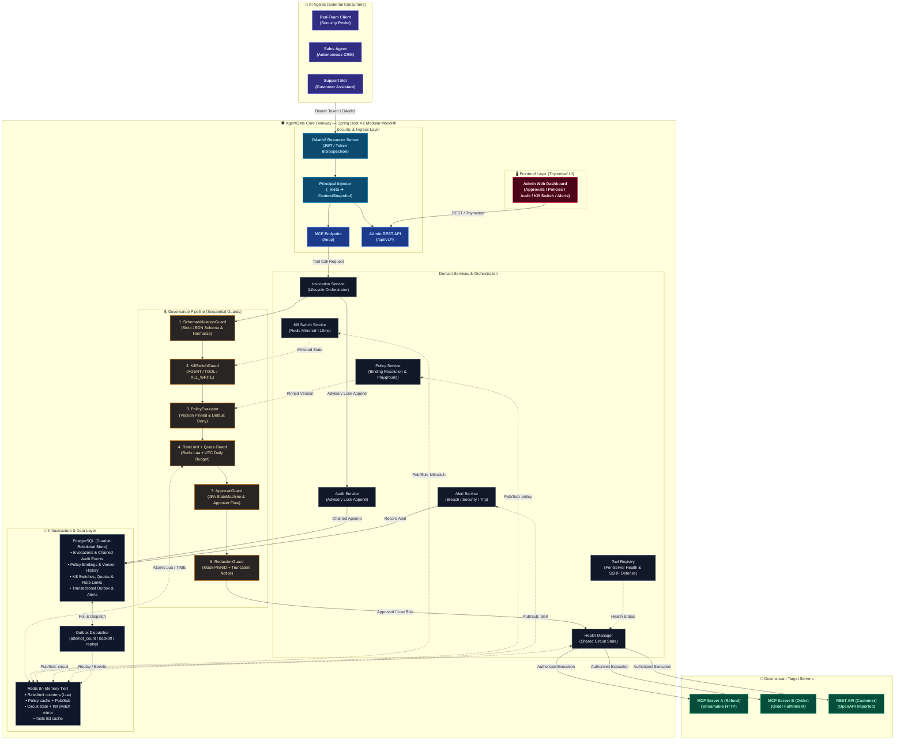
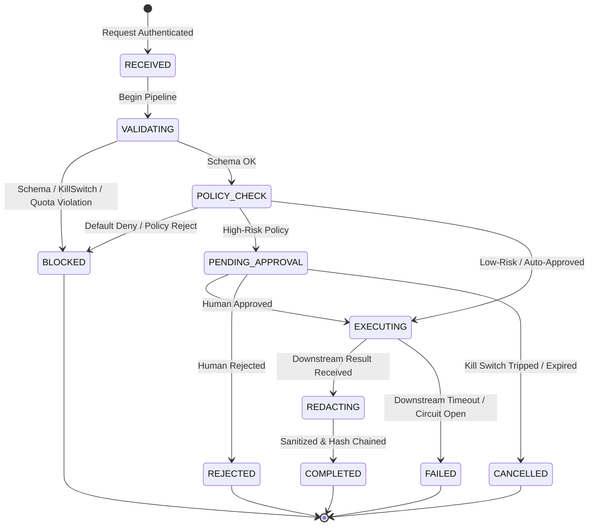
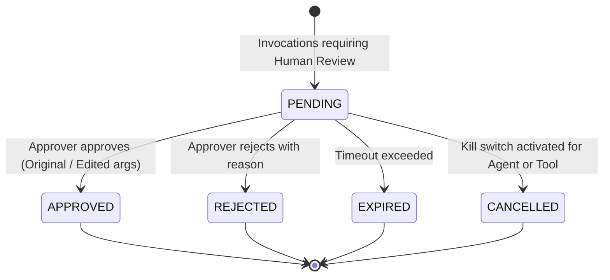

# 🛡️ AgentGate — AI Agent Tool Governance Gateway

[](https://spring.io/projects/spring-boot)
[](https://openjdk.org/)
[](https://spring.io/projects/spring-ai)
[](https://www.postgresql.org/)
[](https://redis.io/)
[](https://resilience4j.readme.io/)
[](LICENSE)

> **AgentGate** is an enterprise-grade, zero-trust governance gateway designed to sit between autonomous AI agents and sensitive backend execution targets (MCP servers & REST APIs). It enforces real-time schema validation, version-pinned policy evaluations, atomic spend/rate quotas, human-in-the-loop approvals, emergency kill switches, and tamper-evident cryptographic audit logs.

---

## 📑 Table of Contents
- [Executive Overview](#-executive-overview)
- [System Architecture](#-system-architecture)
  - [Architecture Diagram (Mermaid)](#architecture-diagram)
  - [Vector Graphic Asset](#vector-graphic-asset)
  - [Architectural Layers Breakdown](#architectural-layers-breakdown)
- [Governance Pipeline & Request Lifecycle](#-governance-pipeline--request-lifecycle)
  - [Sequence Flow Diagram](#sequence-flow-diagram)
  - [The 6-Stage Pluggable Guard Pipeline](#the-6-stage-pluggable-guard-pipeline)
- [Data Model & Entity-Relationship Diagram](#-data-model--entity-relationship-diagram)
  - [Entity-Relationship Diagram (ERD)](#entity-relationship-diagram-erd)
  - [Entity Data Dictionary](#entity-data-dictionary)
  - [State Machine Lifecycles](#state-machine-lifecycles)
- [Security & Architectural Invariants](#-security--architectural-invariants)
- [Technology Stack](#-technology-stack)
- [Project Layout](#-project-layout)
- [Implementation Roadmap](#-implementation-roadmap)
- [Getting Started](#-getting-started)
- [Documentation & ADRs](#-documentation--adrs)

---

## 🌟 Executive Overview

Autonomous AI agents (such as code interpreters, sales bots, and customer support assistants) can invoke backend APIs and MCP tools with side effects. Without strict runtime governance, organizations face severe risks of prompt injection, data exfiltration, unintended bulk writes, financial quota depletion, and untracked actions.

**AgentGate** solves this by acting as an inline proxy and security perimeter:
- **Verified Agent Identity & On-Behalf-Of Trust**: Authenticates agents via OAuth2 Bearer tokens and extracts trusted end-user contexts into an immutable `ContextSnapshot`.
- **Default-Deny Policy Engine**: Evaluates version-pinned, immutable declarative rules with dry-run capabilities and sub-10s hot propagation.
- **Atomic Quotas & Rate Limits**: Prevents denial-of-wallet and cascade failures via Redis Lua scripts synced to UTC midnight boundaries.
- **Human-in-the-Loop Approval**: Suspends high-risk or financial actions, enabling human operators to review, reject, or edit tool arguments with automatic revalidation.
- **Scoped Emergency Kill Switches**: Immediate sub-10ms cessation of write operations at global, agent, or tool scope.
- **Cryptographic Audit Chain**: Every lifecycle transition is recorded in an append-only, tamper-evident SHA-256 hash chain serialized via PostgreSQL advisory locking.
- **Data Redaction & Truncation**: Irreversible masking of sensitive PII (emails, phone numbers, National IDs) and safe output size caps.

---

## 🏗️ System Architecture

AgentGate is structured as a **Spring Boot 4.x Modular Monolith**, optimizing for operational simplicity, strong transactional consistency, and low-latency internal orchestration without microservice overhead.

### Architecture Diagram



### Vector Graphic Asset
A high-resolution standalone SVG version of this architecture is available in the repository:
👉 **[View Clean Architecture Vector SVG](docs/diagrams/architecture_clean.svg)**

### Architectural Layers Breakdown

| Layer | Primary Responsibilities | Key Technologies |
|---|---|---|
| **Security & Ingress** | Authenticate incoming client credentials, validate JWT signatures, reject forged agent headers, extract on-behalf-of end-user claims, build thread-safe `ContextSnapshot`. | Spring Security, OAuth2 Resource Server, Virtual Threads |
| **Domain Services** | Orchestrate tool call lifecycles, enforce policy resolution, manage emergency kill switches, verify tool discovery health, dispatch security alerts. | Spring MVC, Resilience4j, Custom Service Contracts |
| **Governance Pipeline** | Ordered, pluggable chain of 6 mandatory security guards. Halts execution immediately upon any policy, limit, or schema failure before any downstream side effect occurs. | Composite Pattern, Chain of Responsibility, Spring Beans |
| **Frontend UI** | Web management portal for administrators to review and approve pending requests, edit arguments, test policies in a dry-run playground, trigger kill switches, and inspect audit chains. | Thymeleaf, HTML5, Tailwind / Bootstrap, Server-Sent Events |
| **Infrastructure Tier** | Dual-tier persistence: durable relational store for system state, append-only logs, and transactional outbox; high-performance memory store for atomic counters and Pub/Sub notifications. | PostgreSQL 16+, Flyway, Redis 7+ (Lua Scripting) |
| **Downstream Targets** | Internal and external tools providing actual functional capability. Connected via Model Context Protocol (Streamable HTTP) or REST adapters with circuit breaker protection. | Spring AI MCP Client, HTTP Client, OpenAPI Validator |

---

## ⚡ Governance Pipeline & Request Lifecycle

Every tool call entering through the `/mcp` endpoint must traverse the **Governance Pipeline**. The gateway strictly guarantees that **no downstream side effect is ever executed** before all governance checks pass.

### Sequence Flow Diagram

```mermaid
sequenceDiagram
    autonumber
    actor Agent as 🤖 AI Agent
    participant Sec as 🛡️ Security / Ingress
    participant Inv as ⚙️ InvocationService
    participant Pipe as 🔒 Governance Pipeline
    participant Redis as ⚡ Redis Tier
    participant DB as 💾 PostgreSQL
    participant Admin as 👤 Human Approver
    participant Target as 🔌 Downstream Target

    Agent->>Sec: POST /mcp (Tool Call + Bearer Token)
    Sec->>Sec: Authenticate OAuth2 & Build ContextSnapshot
    Sec->>Inv: Handle tool call (agent_id, user_id, tool, args)
    Inv->>DB: Begin Invocation (Status: RECEIVED)
    
    rect rgb(30, 41, 59)
        note over Inv,Pipe: 🔒 Sequential Governance Verification
        Inv->>Pipe: Execute Guards(Context, Tool, Args)
        Pipe->>Pipe: 1. SchemaValidationGuard (Strict JSON Schema)
        Pipe->>Redis: 2. KillSwitchGuard (Authoritative Mirror Check)
        Pipe->>DB: 3. PolicyEvaluator (Resolve Binding & Pin Immutable Version)
        Pipe->>Redis: 4. RateLimit + QuotaGuard (Atomic Lua Script)
        
        opt Human Approval Required (High-Risk Action)
            Pipe->>DB: 5. ApprovalGuard (Persist APPROVAL_REQUEST, Status: PENDING)
            Pipe-->>Agent: Return Pending Handle (Invocation Paused)
            Admin->>DB: Review, Edit Args & Approve via Admin UI
            DB-->>Pipe: Approval Event Triggered
            Pipe->>Pipe: Revalidate Schema & Policy for Edited Arguments
        end
        
        Pipe->>Pipe: 6. RedactionGuard (Apply Irreversible Masking)
    end

    Pipe-->>Inv: Governance PASS (Status: APPROVED)
    Inv->>Redis: Check Downstream Circuit Breaker State
    Inv->>Target: Execute Downstream Call (MCP/REST with Timeout)
    Target-->>Inv: Raw Response Payload
    
    Inv->>Pipe: Post-Execution Redaction & Truncation Check
    Pipe-->>Inv: Sanitized Payload
    
    rect rgb(15, 23, 42)
        note over Inv,DB: 💾 Atomic Audit & Outbox Commit
        Inv->>DB: Acquire PostgreSQL Advisory Lock
        Inv->>DB: Append AUDIT_EVENT (curr_hash = SHA256(prev_hash + seq + payload))
        Inv->>DB: Insert EVENT_PUBLICATION (Transactional Outbox)
        Inv->>DB: Update TOOL_INVOCATION (Status: COMPLETED)
    end
    
    Inv-->>Sec: Safe Execution Result
    Sec-->>Agent: 200 OK (Clean Tool Result)
```



### The 6-Stage Pluggable Guard Pipeline

1. **`SchemaValidationGuard`**:
   - Compares incoming tool arguments against the registered JSON Schema (Draft 7 / 2020-12).
   - Coerces and normalizes valid types; fails fast on unexpected properties, type mismatches, or malformed payloads.
2. **`KillSwitchGuard`**:
   - Queries the local/Redis-mirrored kill-switch registry for active trips: `GLOBAL_WRITES`, `AGENT (<client_id>)`, or `TOOL (<tool_id>)`.
   - Halts requests with `<10ms` overhead. Active kill switches automatically cancel matching pending approvals.
3. **`PolicyEvaluator`**:
   - Resolves effective policies based on scope hierarchy: `GLOBAL` ➔ `AGENT` ➔ `TOOL` ➔ `AGENT_TOOL` with explicit priority ordering.
   - Enforces **default-deny**: if no explicit allow rule matches, the invocation is blocked.
   - Pins the exact, immutable `POLICY_VERSION` to the invocation record for zero-drift reproducibility.
4. **`RateLimit + Quota Guard`**:
   - Executes atomic Redis Lua scripts evaluating token-bucket / sliding-window request limits.
   - Computes daily cumulative spend/token budgets reset strictly at `00:00:00 UTC`.
   - Prevents race conditions and dual-write budget overruns.
5. **`ApprovalGuard`**:
   - Intercepts medium/high-risk tool calls (e.g. fund transfers, order cancellations).
   - Generates an `APPROVAL_REQUEST` tied to a cryptographic SHA-256 digest of the request arguments.
   - Transitions through a JPA state machine: `PENDING` ➔ `APPROVED` / `REJECTED` / `EXPIRED` / `CANCELLED`.
   - If an approver edits arguments, the pipeline forces a **mandatory revalidation** across Schema, Policy, and Quota guards.
6. **`RedactionGuard`**:
   - Inspects both input arguments and downstream output responses.
   - Masks sensitive patterns: email addresses, Bangladesh mobile numbers (`+8801...`), National ID cards (NID), and custom regexes.
   - Enforces strict response length boundaries, appending an explicit truncation disclosure if limits are exceeded.

---

## 🗄️ Data Model & Entity-Relationship Diagram

AgentGate utilizes a fully normalized, relational schema in **PostgreSQL 16+**, version-controlled through **Flyway** migrations.

### Entity-Relationship Diagram (ERD)

```mermaid
erDiagram
    DOWNSTREAM_SERVER ||--o{ TOOL : "hosts"
    AGENT_CLIENT ||--o{ TOOL_INVOCATION : "initiates"
    END_USER ||--o{ TOOL_INVOCATION : "on_behalf_of"
    TOOL ||--o{ TOOL_INVOCATION : "executed_in"
    POLICY ||--|{ POLICY_VERSION : "versions"
    POLICY ||--o{ POLICY_BINDING : "binds"
    POLICY_VERSION ||--o{ TOOL_INVOCATION : "pinned_in"
    TOOL_INVOCATION ||--o{ AUDIT_EVENT : "logs"
    TOOL_INVOCATION ||--o| APPROVAL_REQUEST : "requires"
    TOOL_INVOCATION ||--o{ SECURITY_ALERT : "triggers"
    AGENT_CLIENT ||--o{ POLICY_BINDING : "targeted_by"
    TOOL ||--o{ POLICY_BINDING : "scoped_to"
    AGENT_CLIENT ||--o{ QUOTA_POLICY : "budgeted_for"
    TOOL ||--o{ QUOTA_POLICY : "capped_for"
    AGENT_CLIENT ||--o{ RATE_LIMIT_POLICY : "throttled_by"
    TOOL ||--o{ RATE_LIMIT_POLICY : "rate_limited_by"
    AGENT_CLIENT ||--o{ SECURITY_ALERT : "associated_with"

    AGENT_CLIENT {
        varchar client_id PK "Unique agent client identifier"
        varchar name "Agent system name"
        varchar client_secret_hash "BCrypt/Argon2 secret hash"
        varchar display_name "Human-friendly label"
        varchar status "ACTIVE, REVOKED, SUSPENDED"
        timestamptz created_at "Registration timestamp"
    }

    END_USER {
        varchar user_id PK "Subject identifier"
        varchar external_ref "Verified external subject ref"
        varchar issuer "Trusted IdP issuer"
        varchar clearance_level "SECURITY_ROLE"
        timestamptz created_at "Creation timestamp"
    }

    DOWNSTREAM_SERVER {
        bigint server_id PK "Server unique ID"
        varchar name "Unique server name"
        varchar type "MCP or REST"
        varchar endpoint_url "Target base URL"
        int health_check_interval_sec "Probe frequency"
        int circuit_open_threshold "Consecutive failures to trip"
        timestamptz created_at "Registration timestamp"
    }

    TOOL {
        bigint tool_id PK "Tool primary key"
        bigint server_id FK "Parent server reference"
        varchar name "Unique tool identifier"
        text description "Tool functionality documentation"
        jsonb input_schema "JSON Schema Draft 7/2020-12"
        varchar risk_level "LOW, MEDIUM, HIGH, CRITICAL"
        varchar routing_hint "Execution router hint"
        varchar status "ACTIVE, DEPRECATED, DISABLED"
        timestamptz created_at "Creation timestamp"
    }

    POLICY {
        bigint policy_id PK "Policy primary key"
        varchar name "Human-readable policy name"
        varchar status "ACTIVE, DRAFT, ARCHIVED"
        bigint current_version_id FK "Active version pointer"
        boolean active_version_locks "Immutability lock flag"
        timestamptz created_at "Creation timestamp"
    }

    POLICY_VERSION {
        bigint version_id PK "Version primary key"
        bigint policy_id FK "Owning policy reference"
        int version_number "Monotonic sequence number"
        jsonb rules_tree "Declarative rule logic AST"
        timestamptz effective_from "Activation timestamp"
        varchar audit_by_user "Author administrator ID"
        varchar version_hash "SHA-256 fingerprint"
        timestamptz created_at "Creation timestamp"
    }

    POLICY_BINDING {
        bigint binding_id PK "Binding primary key"
        bigint policy_id FK "Target policy reference"
        varchar agent_id FK "Optional agent client filter"
        bigint tool_id FK "Optional tool filter"
        varchar scope "GLOBAL, AGENT, TOOL, AGENT_TOOL"
        int priority "Evaluation precedence order"
        timestamptz created_at "Creation timestamp"
        timestamptz updated_at "Last update timestamp"
    }

    KILL_SWITCH {
        bigint kill_switch_id PK "Kill switch primary key"
        varchar scope "GLOBAL_WRITES, AGENT, TOOL"
        varchar target_id "Target identifier or null"
        varchar status "ACTIVE, INACTIVE"
        text reason "Incident / operational reason"
        varchar admin_id "Administrator who tripped"
        timestamptz activated_at "Activation timestamp"
        timestamptz deactivated_at "Deactivation timestamp"
    }

    QUOTA_POLICY {
        bigint quota_id PK "Quota rule primary key"
        varchar scope "AGENT, TOOL, AGENT_TOOL"
        varchar agent_id FK "Target agent reference"
        bigint tool_id FK "Target tool reference"
        bigint max_amount "Maximum allowable spend/tokens"
        string window_unit "DAILY_UTC"
        timestamptz created_at "Creation timestamp"
    }

    RATE_LIMIT_POLICY {
        bigint rate_limit_id PK "Rate limit primary key"
        varchar scope "AGENT, TOOL, AGENT_TOOL"
        varchar agent_id FK "Target agent reference"
        bigint tool_id FK "Target tool reference"
        int window_seconds "Sliding window duration"
        int max_requests "Max requests in window"
        timestamptz created_at "Creation timestamp"
    }

    TOOL_INVOCATION {
        bigint invocation_id PK "Invocation primary key"
        uuid event_id "Correlation / Idempotency ID"
        varchar agent_id FK "Authenticated agent"
        varchar user_id FK "Trusted on-behalf-of user"
        bigint tool_id FK "Target tool executed"
        jsonb request_arguments_redacted "Sanitized input arguments"
        jsonb response_payload_redacted "Sanitized output payload"
        varchar status "RECEIVED, APPROVED, EXECUTED, BLOCKED, REJECTED, FAILED"
        varchar error_code "Machine-readable error enum"
        bigint policy_version_id FK "Pinned immutable policy version"
        int latency_ms "Execution roundtrip duration"
        timestamptz created_at "Invocation timestamp"
        timestamptz completed_at "Completion timestamp"
    }

    AUDIT_EVENT {
        bigint audit_id PK "Audit event primary key"
        bigint invocation_id FK "Linked invocation reference"
        bigint sequence_number "Monotonic sequence per chain"
        varchar event_type "INVOCATION_LIFECYCLE_EVENT"
        timestamptz event_time "Event occurrence timestamp"
        jsonb payload "Redacted event context"
        varchar prev_hash "Cryptographic previous hash"
        varchar curr_hash "SHA-256(prev_hash + seq + payload)"
        varchar hash_algorithm "SHA-256"
        varchar actor "Authenticated actor ID"
    }

    APPROVAL_REQUEST {
        bigint approval_id PK "Approval primary key"
        bigint invocation_id FK "Unique invocation pointer (1:1)"
        varchar status "PENDING, APPROVED, REJECTED, EXPIRED, CANCELLED"
        jsonb original_arguments_encrypted "Encrypted original payload"
        jsonb edited_arguments_encrypted "Encrypted modified payload"
        varchar approver_id "Administrator / Approver ID"
        text decision_reason "Human rationale"
        varchar arguments_hash "SHA-256 digest of arguments"
        int version "Optimistic locking counter"
        timestamptz expires_at "Approval deadline timestamp"
        timestamptz created_at "Creation timestamp"
        timestamptz updated_at "Resolution timestamp"
    }

    SECURITY_ALERT {
        bigint alert_id PK "Security alert primary key"
        varchar alert_type "BREACH, TAMPER, RATE_EXCEEDED"
        varchar severity "LOW, MEDIUM, HIGH, CRITICAL"
        varchar triggered_by FK "Agent or System source"
        varchar event_id "Correlation event ID"
        text details "Technical incident context"
        timestamptz acknowledged_at "Admin acknowledgement time"
        timestamptz created_at "Detection timestamp"
    }

    EVENT_PUBLICATION {
        uuid id PK "Outbox event unique ID"
        varchar event_routing_key "Topic / routing subject"
        varchar event_type "Domain event descriptor"
        jsonb event_payload "JSON domain event data"
        varchar listener_id "Target subscriber ID"
        varchar status "PENDING, PUBLISHED, FAILED, RETRYING"
        int attempt_count "Publication delivery attempts"
        timestamptz next_attempt_at "Exponential backoff schedule"
        timestamptz published_at "Successful publication time"
        timestamptz completed_at "Terminal completion timestamp"
        text last_error "Error diagnostic information"
        timestamptz created_at "Transaction commit timestamp"
    }
```



### Vector Graphic Asset
A high-resolution standalone SVG version of this data model is available in the repository:
👉 **[View Clean Data Model Vector SVG](docs/diagrams/erd_clean.svg)**

### Entity Data Dictionary

| # | Entity Name | Primary Key | Key Foreign Keys | Purpose & Key Invariants |
|---|---|---|---|---|
| 1 | `AGENT_CLIENT` | `client_id` (varchar) | — | AI Agent identities. Never stores raw secrets (`client_secret_hash` with BCrypt/Argon2). |
| 2 | `END_USER` | `user_id` (varchar) | — | Trusted human user representation. Unique identity pair `(issuer, external_ref)`. |
| 3 | `DOWNSTREAM_SERVER` | `server_id` (bigint) | — | Host configuration for downstream MCP / REST services, health intervals, and circuit breaker trip thresholds. |
| 4 | `TOOL` | `tool_id` (bigint) | `server_id` | Registered tool catalog, JSON schema definition, risk level classification, and routing metadata. |
| 5 | `POLICY` | `policy_id` (bigint) | `current_version_id` | Logical policy definition container with active version pointer. |
| 6 | `POLICY_VERSION` | `version_id` (bigint) | `policy_id` | **Immutable** rule definition snapshot. Once published, never updated. Enforces deterministic audit replay. |
| 7 | `POLICY_BINDING` | `binding_id` (bigint) | `policy_id`, `agent_id`, `tool_id` | Maps policies to specific scopes (`GLOBAL`, `AGENT`, `TOOL`, `AGENT_TOOL`) with priority ordering. |
| 8 | `KILL_SWITCH` | `kill_switch_id` (bigint) | — | Emergency circuit breakers (`GLOBAL_WRITES`, `AGENT`, `TOOL`). Mirrored into Redis for low-latency checks. |
| 9 | `QUOTA_POLICY` | `quota_id` (bigint) | `agent_id`, `tool_id` | Daily spend / token / cost limits reset at UTC midnight. |
| 10 | `RATE_LIMIT_POLICY` | `rate_limit_id` (bigint) | `agent_id`, `tool_id` | Sliding-window / token-bucket request throttling specifications. |
| 11 | `TOOL_INVOCATION` | `invocation_id` (bigint) | `agent_id`, `user_id`, `tool_id`, `policy_version_id` | Central ledger of all tool executions, sanitized arguments, redacted results, latency, and outcome states. |
| 12 | `AUDIT_EVENT` | `audit_id` (bigint) | `invocation_id` | **Append-only** tamper-evident event log. Contains `prev_hash` and `curr_hash`. DB privileges restrict update/delete. |
| 13 | `APPROVAL_REQUEST` | `approval_id` (bigint) | `invocation_id` (1:1 UNIQUE) | Human-in-the-loop approval workflow. Encrypted original/edited args, argument digest hash, and optimistic lock version. |
| 14 | `SECURITY_ALERT` | `alert_id` (bigint) | `triggered_by` | Records audit tampering, rate-limit abuse, kill-switch triggers, and authorization violations. |
| 15 | `EVENT_PUBLICATION` | `id` (uuid) | — | **Transactional Outbox**. Persisted in same DB transaction as domain state mutations; polled by dispatcher. |

### State Machine Lifecycles

#### Tool Invocation Lifecycle


#### Approval Request Lifecycle


---

## 🔒 Security & Architectural Invariants

AgentGate enforces non-negotiable security guarantees:

1. **Default-Deny Policy Execution**:
   - Tool calls without an explicit matching allow policy are immediately denied.
   - Pinned immutable policy versions guarantee that subsequent policy changes do not alter historic invocation evaluations.
2. **Cryptographic Tamper-Evident Audit Trail**:
   - Each `AUDIT_EVENT` entry computes:
     $$\text{curr\_hash} = \text{SHA256}(\text{prev\_hash} + \text{sequence\_number} + \text{canonical\_payload})$$
   - Concurrency is strictly serialized per chain partition via PostgreSQL transaction-level advisory locks (`pg_advisory_xact_lock`).
   - Database user roles are provisioned without `UPDATE` or `DELETE` privileges on the audit table.
3. **Approval Binding & Revalidation**:
   - An approval request is cryptographically bound to the SHA-256 digest of its arguments (`arguments_hash`).
   - If an administrator modifies arguments before approval, the modified payload is forced through a complete revalidation pass (JSON Schema, Policy, and Quotas) before execution.
4. **SSRF Defense in Tool Registration**:
   - Downstream server registration and OpenAPI imports strictly disallow internal loopback (`127.0.0.1`), link-local (`169.254.0.0/16`), and private RFC 1918 subnets unless explicitly allowlisted in production configs.
5. **No Blind Retries on Write Operations**:
   - If a downstream write times out, it is assigned `UNKNOWN_OUTCOME`. It is never blindly retried to avoid duplicate financial or database mutations.
6. **Transactional Outbox Consistency**:
   - Dual-write failure is eliminated by committing domain events (`EVENT_PUBLICATION`) in the exact same database transaction as the invocation state change.

---

## 💻 Technology Stack

- **Application Framework**: Spring Boot 4.x / Spring Framework 6.x
- **Language**: Java 21 LTS (Virtual Threads enabled)
- **AI Tool Protocol**: Spring AI (Model Context Protocol - Streamable HTTP & stdio)
- **Security**: Spring Security 6.x (OAuth2 Resource Server with JWT & Opaque Tokens)
- **Database & Migrations**: PostgreSQL 16+ with Flyway
- **Fast Tier & Coordination**: Redis 7+ (Lua Scripting, Key-Value Caching, Pub/Sub Invalidation)
- **Fault Tolerance**: Resilience4j (Circuit Breakers, Timeouts, Rate Limiters)
- **Templating & Admin UI**: Thymeleaf, Tailwind CSS / Vanilla CSS
- **Observability**: Spring Boot Actuator, Micrometer, Prometheus Metrics
- **Testing**: JUnit 5, AssertJ, Mockito, Testcontainers (PostgreSQL & Redis)

---

## 📁 Project Layout

```text
AgentGate_Antigravity_Starter/
├── docs/                               # Comprehensive project architecture & ADRs
│   ├── adr/                            # Architecture Decision Records (ADR-0001 to ADR-0008)
│   ├── diagrams/                       # High-resolution architectural and ERD diagrams
│   ├── API_CONVENTIONS.md              # REST DTOs, ApiResponse, error handling
│   ├── ARCHITECTURE.md                 # System architecture baseline & boundaries
│   ├── DATA_MODEL.md                   # Relational semantics & schema baseline
│   ├── IMPLEMENTATION_TRACKER.md       # Phase progress tracking
│   ├── MEMORY.md                       # Durable project memory & functional requirements
│   ├── ONBOARDING_GUIDE.md             # Developer setup and onboarding runbook
│   ├── PRD.md                          # Product Requirements Document
│   ├── QA_ACCEPTANCE_EVIDENCE.md       # Acceptance benchmarks QA1-QA5
│   ├── RUNBOOK.md                      # Operational & deployment procedures
│   ├── SECURITY.md                     # Security invariants and defensive checks
│   ├── TESTING.md                      # Verification strategy & QA acceptance criteria
│   └── TRD.md                          # Technical Requirements Document
├── src/                                # Spring Boot enterprise modular monolith source
│   ├── main/
│   │   ├── java/com/agentgate/
│   │   │   ├── admin/                  # Web administration controller & endpoints
│   │   │   ├── agent/                  # Agent identity and credentials
│   │   │   ├── alert/                  # Security alerts and incident logging
│   │   │   ├── approval/               # Human approval state machine
│   │   │   ├── audit/                  # Cryptographic audit hash chain
│   │   │   ├── health/                 # Resilience4j circuit breakers & health probes
│   │   │   ├── invocation/             # Invocation lifecycle and guard pipeline
│   │   │   ├── killswitch/             # Emergency trip switches
│   │   │   ├── observability/          # Micrometer gateway metrics and telemetry
│   │   │   ├── outbox/                 # Transactional outbox dispatcher
│   │   │   ├── policy/                 # Declarative policy engine and AST evaluation
│   │   │   ├── quota/                  # Daily spend and rate quotas (Redis Lua)
│   │   │   ├── security/               # OAuth2 security filter chain & tokens
│   │   │   ├── shared/                 # Common records, DTOs, and global exceptions
│   │   │   └── tool/                   # Tool registry, MCP & REST adapters
│   │   └── resources/
│   │       ├── db/migration/           # Flyway SQL migrations
│   │       ├── static/css/             # Bespoke zero-trust design system CSS
│   │       └── templates/              # Thymeleaf administration pages
│   └── test/                           # Comprehensive test suite (Acceptance, Security, Resilience)
├── pom.xml                             # Maven build configuration
├── docker-compose.yml                  # Infrastructure container definitions (PostgreSQL, Redis)
└── README.md                           # Main repository documentation
```

---

## 🗺️ Implementation Roadmap

The project follows a rigorous, phased implementation lifecycle tracked in [`docs/IMPLEMENTATION_TRACKER.md`](docs/IMPLEMENTATION_TRACKER.md):

- [ ] **Phase 0 — Foundation & Infrastructure**: Docker Compose (PostgreSQL, Redis), Flyway baseline, Maven Spring Boot skeleton, and ADR ratification.
- [ ] **Phase 1 — Identity & Tool Registry**: OAuth2 Resource Server, agent registry, downstream server registration, OpenAPI SSRF-safe import, and MCP discovery.
- [ ] **Phase 2 — Schema Validation & Policy Engine**: JSON Schema validator, immutable policy versions, scope bindings, default deny, and policy playground.
- [ ] **Phase 3 — Invocation Lifecycle & Tamper-Evident Audit**: Lifecycle orchestration, SHA-256 hash chaining, advisory locks, and transactional outbox.
- [ ] **Phase 4 — Human Approval & Kill Switches**: Approval state machine, webhook notifications, argument editing revalidation, and Redis-mirrored kill switches.
- [ ] **Phase 5 — Limits, Redaction & Resilience**: Redis Lua rate limits, UTC daily quotas, PII redaction (email, BD phone, NID), and circuit breaker health probes.
- [ ] **Phase 6 — Admin Dashboard & QA Acceptance**: Thymeleaf dashboard, Micrometer metrics, and evidence production for QA1–QA5 benchmarks.

---

## 🚀 Getting Started

### Prerequisites
- **Java Development Kit (JDK)**: OpenJDK 21 or higher
- **Build Tool**: Apache Maven 3.9+ (or use the included `./mvnw`)
- **Git**
- *(Optional)* **Docker & Docker Compose**: Only needed if running production PostgreSQL 16 & Redis 7. For local testing and grading, built-in SQLite requires zero external services.

### 1. Clone the Repository
```bash
git clone https://github.com/mitulkabirbadhon7/AgentGate-.git
cd AgentGate-
```

### 2. Choose Execution Mode

#### Option A: Zero-Setup SQLite Mode (Default — Recommended for Grading & Local Testing)
No Docker daemon, PostgreSQL, or Redis installation required! The gateway automatically provisions the embedded SQLite database at `./data/agentgate.db` and bootstraps default governance demo data.
```bash
# Run Spring Boot (defaults to SQLite automated mode)
./mvnw spring-boot:run
```
*(On Windows PowerShell, if explicitly specifying the profile flag, wrap in quotes: `./mvnw spring-boot:run "-Dspring-boot.run.profiles=sqlite"`)*

#### Option B: Production Containerized Mode (PostgreSQL 16 + Redis 7)
```bash
# Launch PostgreSQL 16 and Redis 7 in background
docker compose up -d

# Verify containers are healthy
docker compose ps

# Run Spring Boot gateway with postgres profile
./mvnw spring-boot:run "-Dspring-boot.run.profiles=postgres"
```

### 3. Step-by-Step Verification & Endpoints

Once started, test the application via browser, curl, or PowerShell:

1. **Admin Control Dashboard**:
   - URL: `http://localhost:8080/admin` (or `/dashboard`)
   - Default Credentials: `admin` / `admin_gate_change_me`
   - Features: Real-time telemetry, kill switches, human approval queue, rate limit status, and audit verification.

2. **Actuator Health & Metrics**:
   ```bash
   curl http://localhost:8080/actuator/health
   # Expected: {"status":"UP","groups":["liveness","readiness"]}
   ```

3. **Acquire JWT Bearer Token (Bootstrap Demo Agent)**:
   ```bash
   curl -s http://localhost:8080/api/v1/auth/token?clientId=demo-agent
   # Returns: {"success":true,"data":{"access_token":"eyJhbGciOi...","token_type":"Bearer","expires_in":3600}}
   ```

4. **MCP Tool Discovery Endpoint**:
   ```bash
   # Supply the Bearer token acquired above:
   curl -X POST http://localhost:8080/mcp \
     -H "Content-Type: application/json" \
     -H "Authorization: Bearer <ACCESS_TOKEN>" \
     -d '{"jsonrpc":"2.0","method":"tools/list","id":1}'
   ```

5. **REST Tool Invocation Endpoint**:
   ```bash
   curl -X POST http://localhost:8080/api/v1/invocations \
     -H "Content-Type: application/json" \
     -H "Authorization: Bearer <ACCESS_TOKEN>" \
     -d '{"toolName":"weather_service","arguments":{"city":"London"}}'
   # Returns governed result: {"success":true,"data":{"status":"EXECUTED", ...}}
   ```

6. **Verify Cryptographic SHA-256 Audit Trail**:
   Visit `http://localhost:8080/audit` in your browser to inspect the tamper-evident cryptographic hash chain recording the invocation.

---

## 📚 Documentation & ADRs

Detailed technical specifications, functional requirements, and architecture design rationale are available in the [`docs/`](docs/) directory:
- 📄 [Product Requirements Document (PRD)](docs/PRD.md)
- ⚙️ [Technical Requirements Document (TRD)](docs/TRD.md)
- 🏛️ [Architecture Baseline & Invariants](docs/ARCHITECTURE.md)
- 🗄️ [Data Model & Migration Semantics](docs/DATA_MODEL.md)
- 🔐 [Security Controls & SSRF Defense](docs/SECURITY.md)
- 📡 [API Conventions & Error Handling](docs/API_CONVENTIONS.md)
- 🧪 [Testing Strategy & Acceptance Benchmarks](docs/TESTING.md)
- 🧠 [Durable Project Memory](docs/MEMORY.md)
- 📈 [Implementation Tracker](docs/IMPLEMENTATION_TRACKER.md)
- 📑 [Architecture Decision Records (ADRs)](docs/adr/)

---

## 📄 License
This project is licensed under the Apache License 2.0.
