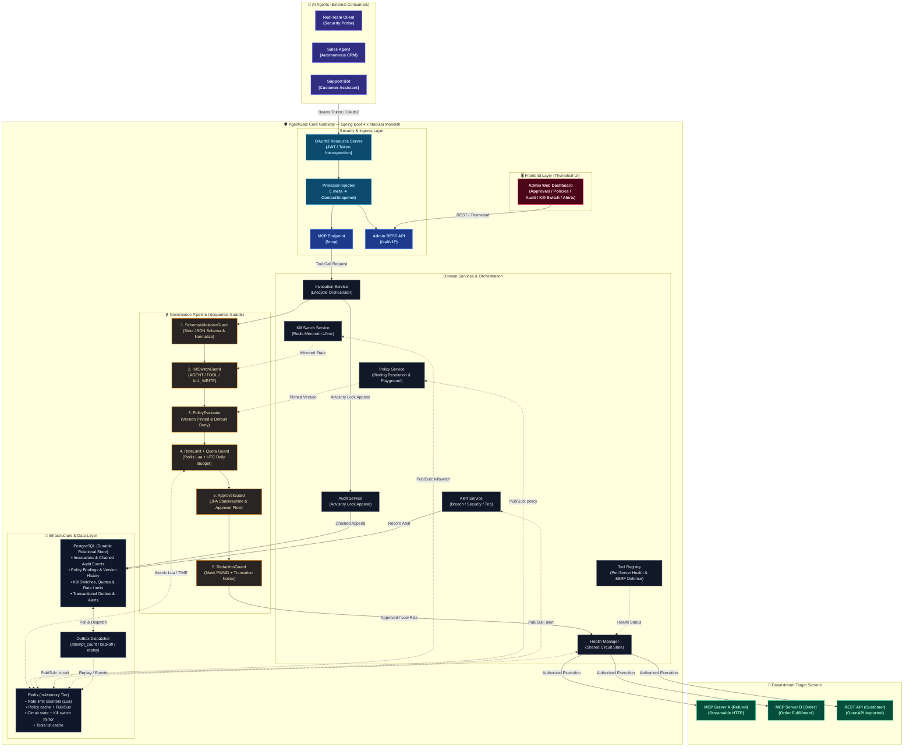

# AgentGate — Architecture Specification

## Overview & Style
AgentGate is architected as a **Spring Boot 4.x Modular Monolith**. It serves as an inline zero-trust governance gateway for AI agent tool invocations, mediating between external AI clients and sensitive downstream systems (MCP servers and REST APIs). Microservice decomposition is prohibited without an accepted Architecture Decision Record (ADR).

---

## 🏛️ System Architecture Diagram

*Vector diagram available at:* `docs/diagrams/architecture_clean.svg`

---

## 🔒 Request Governance Pipeline

```mermaid
sequenceDiagram
    autonumber
    actor Agent as 🤖 AI Agent
    participant Sec as 🛡️ Security / Ingress
    participant Inv as ⚙️ InvocationService
    participant Pipe as 🔒 Governance Pipeline
    participant Redis as ⚡ Redis Tier
    participant DB as 💾 PostgreSQL
    participant Admin as 👤 Human Approver
    participant Target as 🔌 Downstream Target

    Agent->>Sec: POST /mcp (Tool Call + Bearer Token)
    Sec->>Sec: Authenticate OAuth2 & Build ContextSnapshot
    Sec->>Inv: Handle tool call (agent_id, user_id, tool, args)
    Inv->>DB: Begin Invocation (Status: RECEIVED)
    
    rect rgb(30, 41, 59)
        note over Inv,Pipe: 🔒 Sequential Governance Verification
        Inv->>Pipe: Execute Guards(Context, Tool, Args)
        Pipe->>Pipe: 1. SchemaValidationGuard (Strict JSON Schema)
        Pipe->>Redis: 2. KillSwitchGuard (Authoritative Mirror Check)
        Pipe->>DB: 3. PolicyEvaluator (Resolve Binding & Pin Immutable Version)
        Pipe->>Redis: 4. RateLimit + QuotaGuard (Atomic Lua Script)
        
        opt Human Approval Required (High-Risk Action)
            Pipe->>DB: 5. ApprovalGuard (Persist APPROVAL_REQUEST, Status: PENDING)
            Pipe-->>Agent: Return Pending Handle (Invocation Paused)
            Admin->>DB: Review, Edit Args & Approve via Admin UI
            DB-->>Pipe: Approval Event Triggered
            Pipe->>Pipe: Revalidate Schema & Policy for Edited Arguments
        end
        
        Pipe->>Pipe: 6. RedactionGuard (Apply Irreversible Masking)
    end

    Pipe-->>Inv: Governance PASS (Status: APPROVED)
    Inv->>Redis: Check Downstream Circuit Breaker State
    Inv->>Target: Execute Downstream Call (MCP/REST with Timeout)
    Target-->>Inv: Raw Response Payload
    
    Inv->>Pipe: Post-Execution Redaction & Truncation Check
    Pipe-->>Inv: Sanitized Payload
    
    rect rgb(15, 23, 42)
        note over Inv,DB: 💾 Atomic Audit & Outbox Commit
        Inv->>DB: Acquire PostgreSQL Advisory Lock
        Inv->>DB: Append AUDIT_EVENT (curr_hash = SHA256(prev_hash + seq + payload))
        Inv->>DB: Insert EVENT_PUBLICATION (Transactional Outbox)
        Inv->>DB: Update TOOL_INVOCATION (Status: COMPLETED)
    end
    
    Inv-->>Sec: Safe Execution Result
    Sec-->>Agent: 200 OK (Clean Tool Result)
```

---

## 🧩 Architectural Components

### 1. Security & Ingress Boundary
- **OAuth2 Resource Server**: Validates bearer tokens (JWT or opaque via introspection), verifying issuer, audience, and scope constraints.
- **Principal Injector**: Maps authenticated agent identity and trusted on-behalf-of end-user claims (`_meta`) into an immutable `ContextSnapshot`. Forged caller headers are rejected.
- **MCP Ingress Endpoint (`/mcp`)**: Implements the Model Context Protocol (Streamable HTTP / JSON-RPC). Exposes tool discovery and tool execution interfaces.
- **Admin REST API (`/api/v1/*`)**: Admin endpoints for policies, kill switches, approvals, and audits utilizing `ApiResponse<T>` and `ApiError` conventions.

### 2. Domain Services
- **`InvocationService`**: Owns the invocation lifecycle state machine and orchestrates pipeline guards.
- **`AuditService`**: Appends audit events into a tamper-evident cryptographic hash chain serialized via PostgreSQL advisory locking.
- **`PolicyService`**: Manages policy lifecycle, version immutability, binding resolution, and dry-run execution.
- **`KillSwitchService`**: Controls global-write, agent, and tool kill switches with Redis mirror sync.
- **`ToolRegistryService`**: Manages tool registration, downstream server discovery, and OpenAPI import with SSRF defenses.
- **`HealthManager`**: Integrates Resilience4j circuit breakers and Redis shared state. Hides degraded tools from agent discovery.
- **`AlertService`**: Handles security alerts, rate limit violations, and system trips.

### 3. Governance Guards (Composite Pipeline)
1. `SchemaValidationGuard`: JSON Schema validation and argument normalization.
2. `KillSwitchGuard`: Low-latency emergency write cessation.
3. `PolicyEvaluator`: Pinned immutable policy version evaluation with default-deny semantics.
4. `RateLimit + Quota Guard`: Atomic token-bucket / sliding window rate limits and UTC daily spend caps in Redis.
5. `ApprovalGuard`: Persisted JPA state machine for human-in-the-loop review.
6. `RedactionGuard`: Irreversible masking of PII (emails, BD phone numbers, NID) and output truncation notices.

### 4. Infrastructure & Data Tier
- **PostgreSQL 16+**: Authoritative persistent store managed by Flyway migrations.
- **Redis 7+**: In-memory tier for atomic Lua rate limit counters, policy cache, kill switch mirrors, and circuit breaker states.
- **OutboxDispatcher**: Polling dispatcher executing transactional outbox delivery with exponential backoff and dead-letter replay.

---

## 🛡️ Critical Invariants
- **Approval Argument Digest**: Approvals are cryptographically bound to `invocation_id` and `arguments_hash`. Edited arguments must undergo complete revalidation.
- **Serialized Audit Chain**: Concurrency on the audit hash chain is explicitly serialized via PostgreSQL advisory locks.
- **Transactional Outbox**: Outbox records are inserted in the exact same transaction as the domain state change.
- **Fail-Closed Policy**: Medium and high-risk tool calls fail closed if the policy store is unreachable. Low-risk tool calls may use cached policy for at most 5 minutes.
- **Unknown Outcome on Write Timeout**: Downstream timeouts on non-idempotent write operations receive `UNKNOWN_OUTCOME` and are never blindly retried.
