# AgentGate — Data Model & Relational Schema Specification

## Overview
This document specifies the PostgreSQL 16+ relational schema, primary/foreign key relationships, column data types, constraints, and relational invariants for AgentGate. All database schema changes are managed strictly through Flyway migrations.

---

## 🗄️ Entity-Relationship Diagram (ERD)

```mermaid
erDiagram
    DOWNSTREAM_SERVER ||--o{ TOOL : "hosts"
    AGENT_CLIENT ||--o{ TOOL_INVOCATION : "initiates"
    END_USER ||--o{ TOOL_INVOCATION : "on_behalf_of"
    TOOL ||--o{ TOOL_INVOCATION : "executed_in"
    POLICY ||--|{ POLICY_VERSION : "versions"
    POLICY ||--o{ POLICY_BINDING : "binds"
    POLICY_VERSION ||--o{ TOOL_INVOCATION : "pinned_in"
    TOOL_INVOCATION ||--o{ AUDIT_EVENT : "logs"
    TOOL_INVOCATION ||--o| APPROVAL_REQUEST : "requires"
    TOOL_INVOCATION ||--o{ SECURITY_ALERT : "triggers"
    AGENT_CLIENT ||--o{ POLICY_BINDING : "targeted_by"
    TOOL ||--o{ POLICY_BINDING : "scoped_to"
    AGENT_CLIENT ||--o{ QUOTA_POLICY : "budgeted_for"
    TOOL ||--o{ QUOTA_POLICY : "capped_for"
    AGENT_CLIENT ||--o{ RATE_LIMIT_POLICY : "throttled_by"
    TOOL ||--o{ RATE_LIMIT_POLICY : "rate_limited_by"
    AGENT_CLIENT ||--o{ SECURITY_ALERT : "associated_with"

    AGENT_CLIENT {
        varchar client_id PK "Unique agent client identifier"
        varchar name "Agent system name"
        varchar client_secret_hash "BCrypt/Argon2 secret hash"
        varchar display_name "Human-friendly label"
        varchar status "ACTIVE, REVOKED, SUSPENDED"
        timestamptz created_at "Registration timestamp"
    }

    END_USER {
        varchar user_id PK "Subject identifier"
        varchar external_ref "Verified external subject ref"
        varchar issuer "Trusted IdP issuer"
        varchar clearance_level "SECURITY_ROLE"
        timestamptz created_at "Creation timestamp"
    }

    DOWNSTREAM_SERVER {
        bigint server_id PK "Server unique ID"
        varchar name "Unique server name"
        varchar type "MCP or REST"
        varchar endpoint_url "Target base URL"
        int health_check_interval_sec "Probe frequency"
        int circuit_open_threshold "Consecutive failures to trip"
        timestamptz created_at "Registration timestamp"
    }

    TOOL {
        bigint tool_id PK "Tool primary key"
        bigint server_id FK "Parent server reference"
        varchar name "Unique tool identifier"
        text description "Tool functionality documentation"
        jsonb input_schema "JSON Schema Draft 7/2020-12"
        varchar risk_level "LOW, MEDIUM, HIGH, CRITICAL"
        varchar routing_hint "Execution router hint"
        varchar status "ACTIVE, DEPRECATED, DISABLED"
        timestamptz created_at "Creation timestamp"
    }

    POLICY {
        bigint policy_id PK "Policy primary key"
        varchar name "Human-readable policy name"
        varchar status "ACTIVE, DRAFT, ARCHIVED"
        bigint current_version_id FK "Active version pointer"
        boolean active_version_locks "Immutability lock flag"
        timestamptz created_at "Creation timestamp"
    }

    POLICY_VERSION {
        bigint version_id PK "Version primary key"
        bigint policy_id FK "Owning policy reference"
        int version_number "Monotonic sequence number"
        jsonb rules_tree "Declarative rule logic AST"
        timestamptz effective_from "Activation timestamp"
        varchar audit_by_user "Author administrator ID"
        varchar version_hash "SHA-256 fingerprint"
        timestamptz created_at "Creation timestamp"
    }

    POLICY_BINDING {
        bigint binding_id PK "Binding primary key"
        bigint policy_id FK "Target policy reference"
        varchar agent_id FK "Optional agent client filter"
        bigint tool_id FK "Optional tool filter"
        varchar scope "GLOBAL, AGENT, TOOL, AGENT_TOOL"
        int priority "Evaluation precedence order"
        timestamptz created_at "Creation timestamp"
        timestamptz updated_at "Last update timestamp"
    }

    KILL_SWITCH {
        bigint kill_switch_id PK "Kill switch primary key"
        varchar scope "GLOBAL_WRITES, AGENT, TOOL"
        varchar target_id "Target identifier or null"
        varchar status "ACTIVE, INACTIVE"
        text reason "Incident / operational reason"
        varchar admin_id "Administrator who tripped"
        timestamptz activated_at "Activation timestamp"
        timestamptz deactivated_at "Deactivation timestamp"
    }

    QUOTA_POLICY {
        bigint quota_id PK "Quota rule primary key"
        varchar scope "AGENT, TOOL, AGENT_TOOL"
        varchar agent_id FK "Target agent reference"
        bigint tool_id FK "Target tool reference"
        bigint max_amount "Maximum allowable spend/tokens"
        string window_unit "DAILY_UTC"
        timestamptz created_at "Creation timestamp"
    }

    RATE_LIMIT_POLICY {
        bigint rate_limit_id PK "Rate limit primary key"
        varchar scope "AGENT, TOOL, AGENT_TOOL"
        varchar agent_id FK "Target agent reference"
        bigint tool_id FK "Target tool reference"
        int window_seconds "Sliding window duration"
        int max_requests "Max requests in window"
        timestamptz created_at "Creation timestamp"
    }

    TOOL_INVOCATION {
        bigint invocation_id PK "Invocation primary key"
        uuid event_id "Correlation / Idempotency ID"
        varchar agent_id FK "Authenticated agent"
        varchar user_id FK "Trusted on-behalf-of user"
        bigint tool_id FK "Target tool executed"
        jsonb request_arguments_redacted "Sanitized input arguments"
        jsonb response_payload_redacted "Sanitized output payload"
        varchar status "RECEIVED, APPROVED, EXECUTED, BLOCKED, REJECTED, FAILED"
        varchar error_code "Machine-readable error enum"
        bigint policy_version_id FK "Pinned immutable policy version"
        int latency_ms "Execution roundtrip duration"
        timestamptz created_at "Invocation timestamp"
        timestamptz completed_at "Completion timestamp"
    }

    AUDIT_EVENT {
        bigint audit_id PK "Audit event primary key"
        bigint invocation_id FK "Linked invocation reference"
        bigint sequence_number "Monotonic sequence per chain"
        varchar event_type "INVOCATION_LIFECYCLE_EVENT"
        timestamptz event_time "Event occurrence timestamp"
        jsonb payload "Redacted event context"
        string prev_hash "Cryptographic previous hash"
        string curr_hash "SHA-256(prev_hash + seq + payload)"
        varchar hash_algorithm "SHA-256"
        varchar actor "Authenticated actor ID"
    }

    APPROVAL_REQUEST {
        bigint approval_id PK "Approval primary key"
        bigint invocation_id FK "Unique invocation pointer (1:1)"
        varchar status "PENDING, APPROVED, REJECTED, EXPIRED, CANCELLED"
        jsonb original_arguments_encrypted "Encrypted original payload"
        jsonb edited_arguments_encrypted "Encrypted modified payload"
        varchar approver_id "Administrator / Approver ID"
        text decision_reason "Human rationale"
        varchar arguments_hash "SHA-256 digest of arguments"
        int version "Optimistic locking counter"
        timestamptz expires_at "Approval deadline timestamp"
        timestamptz created_at "Creation timestamp"
        timestamptz updated_at "Resolution timestamp"
    }

    SECURITY_ALERT {
        bigint alert_id PK "Security alert primary key"
        varchar alert_type "BREACH, TAMPER, RATE_EXCEEDED"
        varchar severity "LOW, MEDIUM, HIGH, CRITICAL"
        varchar triggered_by FK "Agent or System source"
        varchar event_id "Correlation event ID"
        text details "Technical incident context"
        timestamptz acknowledged_at "Admin acknowledgement time"
        timestamptz created_at "Detection timestamp"
    }

    EVENT_PUBLICATION {
        uuid id PK "Outbox event unique ID"
        varchar event_routing_key "Topic / routing subject"
        varchar event_type "Domain event descriptor"
        jsonb event_payload "JSON domain event data"
        varchar listener_id "Target subscriber ID"
        varchar status "PENDING, PUBLISHED, FAILED, RETRYING"
        int attempt_count "Publication delivery attempts"
        timestamptz next_attempt_at "Exponential backoff schedule"
        timestamptz published_at "Successful publication time"
        timestamptz completed_at "Terminal completion timestamp"
        text last_error "Error diagnostic information"
        timestamptz created_at "Transaction commit timestamp"
    }
```

*Vector diagram available at:* `docs/diagrams/erd_clean.svg`

---

## 📋 Comprehensive Entity Specifications

### 1. `AGENT_CLIENT`
Stores registered AI Agent credentials and operational statuses.
- `client_id` (`VARCHAR(64)` PRIMARY KEY): Client credentials identifier.
- `name` (`VARCHAR(128)` NOT NULL): Unique agent identifier.
- `client_secret_hash` (`VARCHAR(255)` NOT NULL): Salted BCrypt/Argon2 password hash. Raw secret is never persisted.
- `display_name` (`VARCHAR(128)`): Human-friendly description.
- `status` (`VARCHAR(32)` NOT NULL): `ACTIVE`, `SUSPENDED`, `REVOKED`.
- `created_at` (`TIMESTAMPTZ` NOT NULL DEFAULT clock_timestamp()).

### 2. `END_USER`
Trusted human user contexts on whose behalf an agent is acting.
- `user_id` (`VARCHAR(64)` PRIMARY KEY): Internal system user ID.
- `external_ref` (`VARCHAR(128)` NOT NULL): Subject claim from trusted Identity Provider.
- `issuer` (`VARCHAR(255)` NOT NULL): Issuer URI of the external IdP.
- `clearance_level` (`VARCHAR(32)` NOT NULL): User security clearance or role tier.
- `created_at` (`TIMESTAMPTZ` NOT NULL DEFAULT clock_timestamp()).
- *Constraints*: `UNIQUE(issuer, external_ref)`.

### 3. `DOWNSTREAM_SERVER`
Target backend servers hosting executable tools.
- `server_id` (`BIGINT` GENERATED ALWAYS AS IDENTITY PRIMARY KEY).
- `name` (`VARCHAR(128)` NOT NULL UNIQUE).
- `type` (`VARCHAR(32)` NOT NULL): `MCP` or `REST`.
- `endpoint_url` (`VARCHAR(512)` NOT NULL): Target URL. Validated against SSRF rules.
- `health_check_interval_sec` (`INT` NOT NULL DEFAULT 30).
- `circuit_open_threshold` (`INT` NOT NULL DEFAULT 5).
- `created_at` (`TIMESTAMPTZ` NOT NULL DEFAULT clock_timestamp()).

### 4. `TOOL`
Exposed tool definitions.
- `tool_id` (`BIGINT` GENERATED ALWAYS AS IDENTITY PRIMARY KEY).
- `server_id` (`BIGINT` NOT NULL REFERENCES `DOWNSTREAM_SERVER(server_id)`).
- `name` (`VARCHAR(128)` NOT NULL UNIQUE): Tool invocation name exposed in MCP discovery.
- `description` (`TEXT`): Detailed documentation for agent LLMs.
- `input_schema` (`JSONB` NOT NULL): JSON Schema (Draft 7 / 2020-12) defining parameter rules.
- `risk_level` (`VARCHAR(32)` NOT NULL): `LOW`, `MEDIUM`, `HIGH`, `CRITICAL`.
- `routing_hint` (`VARCHAR(128)`).
- `status` (`VARCHAR(32)` NOT NULL DEFAULT 'ACTIVE'): `ACTIVE`, `DEPRECATED`, `DISABLED`.
- `created_at` (`TIMESTAMPTZ` NOT NULL DEFAULT clock_timestamp()).

### 5. `POLICY` & `POLICY_VERSION`
Declarative governance rule engine.
- `POLICY`:
  - `policy_id` (`BIGINT` GENERATED ALWAYS AS IDENTITY PRIMARY KEY).
  - `name` (`VARCHAR(128)` NOT NULL UNIQUE).
  - `status` (`VARCHAR(32)` NOT NULL): `ACTIVE`, `DRAFT`, `ARCHIVED`.
  - `current_version_id` (`BIGINT` REFERENCES `POLICY_VERSION(version_id)`).
  - `active_version_locks` (`BOOLEAN` NOT NULL DEFAULT TRUE).
- `POLICY_VERSION` (**Immutable**):
  - `version_id` (`BIGINT` GENERATED ALWAYS AS IDENTITY PRIMARY KEY).
  - `policy_id` (`BIGINT` NOT NULL REFERENCES `POLICY(policy_id)` ON DELETE CASCADE).
  - `version_number` (`INT` NOT NULL).
  - `rules_tree` (`JSONB` NOT NULL): Abstract syntax tree of rule conditions.
  - `effective_from` (`TIMESTAMPTZ` NOT NULL).
  - `audit_by_user` (`VARCHAR(128)` NOT NULL): Author identity.
  - `version_hash` (`VARCHAR(64)` NOT NULL): SHA-256 fingerprint of the `rules_tree`.
  - `created_at` (`TIMESTAMPTZ` NOT NULL DEFAULT clock_timestamp()).
  - *Constraints*: `UNIQUE(policy_id, version_number)`.

### 6. `POLICY_BINDING`
Associates policies to agents, tools, or global scopes.
- `binding_id` (`BIGINT` GENERATED ALWAYS AS IDENTITY PRIMARY KEY).
- `policy_id` (`BIGINT` NOT NULL REFERENCES `POLICY(policy_id)`).
- `agent_id` (`VARCHAR(64)` REFERENCES `AGENT_CLIENT(client_id)`).
- `tool_id` (`BIGINT` REFERENCES `TOOL(tool_id)`).
- `scope` (`VARCHAR(32)` NOT NULL): `GLOBAL`, `AGENT`, `TOOL`, `AGENT_TOOL`.
- `priority` (`INT` NOT NULL DEFAULT 100): Lower integer indicates higher evaluation precedence.
- `created_at` (`TIMESTAMPTZ` NOT NULL DEFAULT clock_timestamp()).
- `updated_at` (`TIMESTAMPTZ` NOT NULL DEFAULT clock_timestamp()).
- *Constraints*: CHECK scope consistency:
  - `GLOBAL`: `agent_id IS NULL AND tool_id IS NULL`
  - `AGENT`: `agent_id IS NOT NULL AND tool_id IS NULL`
  - `TOOL`: `agent_id IS NULL AND tool_id IS NOT NULL`
  - `AGENT_TOOL`: `agent_id IS NOT NULL AND tool_id IS NOT NULL`

### 7. `KILL_SWITCH`
Emergency circuit breakers halting tool executions immediately.
- `kill_switch_id` (`BIGINT` GENERATED ALWAYS AS IDENTITY PRIMARY KEY).
- `scope` (`VARCHAR(32)` NOT NULL): `GLOBAL_WRITES`, `AGENT`, `TOOL`.
- `target_id` (`VARCHAR(128)`): ID of agent client or tool (NULL for `GLOBAL_WRITES`).
- `status` (`VARCHAR(32)` NOT NULL DEFAULT 'ACTIVE'): `ACTIVE`, `INACTIVE`.
- `reason` (`TEXT` NOT NULL): Incident rationale.
- `admin_id` (`VARCHAR(128)` NOT NULL): Administrator tripping the switch.
- `activated_at` (`TIMESTAMPTZ` NOT NULL DEFAULT clock_timestamp()).
- `deactivated_at` (`TIMESTAMPTZ`).

### 8. `QUOTA_POLICY` & `RATE_LIMIT_POLICY`
Spend caps and request throttling.
- `QUOTA_POLICY`:
  - `quota_id` (`BIGINT` GENERATED ALWAYS AS IDENTITY PRIMARY KEY).
  - `scope` (`VARCHAR(32)` NOT NULL): `AGENT`, `TOOL`, `AGENT_TOOL`.
  - `agent_id` (`VARCHAR(64)` REFERENCES `AGENT_CLIENT(client_id)`).
  - `tool_id` (`BIGINT` REFERENCES `TOOL(tool_id)`).
  - `max_amount` (`BIGINT` NOT NULL): Spend budget in minor currency units (BDT/USD) or tokens.
  - `window_unit` (`VARCHAR(32)` NOT NULL DEFAULT 'DAILY_UTC').
- `RATE_LIMIT_POLICY`:
  - `rate_limit_id` (`BIGINT` GENERATED ALWAYS AS IDENTITY PRIMARY KEY).
  - `scope` (`VARCHAR(32)` NOT NULL): `AGENT`, `TOOL`, `AGENT_TOOL`.
  - `agent_id` (`VARCHAR(64)` REFERENCES `AGENT_CLIENT(client_id)`).
  - `tool_id` (`BIGINT` REFERENCES `TOOL(tool_id)`).
  - `window_seconds` (`INT` NOT NULL): Window duration (e.g. 60s).
  - `max_requests` (`INT` NOT NULL): Max allowed calls in window.

### 9. `TOOL_INVOCATION`
Primary transaction ledger for all tool calls.
- `invocation_id` (`BIGINT` GENERATED ALWAYS AS IDENTITY PRIMARY KEY).
- `event_id` (`UUID` NOT NULL UNIQUE): Correlation and idempotency identifier.
- `agent_id` (`VARCHAR(64)` NOT NULL REFERENCES `AGENT_CLIENT(client_id)`).
- `user_id` (`VARCHAR(64)` REFERENCES `END_USER(user_id)`).
- `tool_id` (`BIGINT` NOT NULL REFERENCES `TOOL(tool_id)`).
- `request_arguments_redacted` (`JSONB` NOT NULL): Arguments after PII redaction.
- `response_payload_redacted` (`JSONB`): Output payload after PII redaction.
- `status` (`VARCHAR(32)` NOT NULL): `RECEIVED`, `APPROVED`, `EXECUTED`, `BLOCKED`, `REJECTED`, `FAILED`.
- `error_code` (`VARCHAR(64)`): Machine-readable failure enum.
- `policy_version_id` (`BIGINT` REFERENCES `POLICY_VERSION(version_id)`): Immutable pinned policy version.
- `latency_ms` (`INT`): Downstream execution duration in milliseconds.
- `created_at` (`TIMESTAMPTZ` NOT NULL DEFAULT clock_timestamp()).
- `completed_at` (`TIMESTAMPTZ`).

### 10. `AUDIT_EVENT` (**Append-Only**)
Cryptographic tamper-evident audit trail.
- `audit_id` (`BIGINT` GENERATED ALWAYS AS IDENTITY PRIMARY KEY).
- `invocation_id` (`BIGINT` NOT NULL REFERENCES `TOOL_INVOCATION(invocation_id)`).
- `sequence_number` (`BIGINT` NOT NULL): Monotonically incremented sequence counter.
- `event_type` (`VARCHAR(64)` NOT NULL): `INVOCATION_RECEIVED`, `POLICY_EVALUATED`, `APPROVAL_PENDING`, `DOWNSTREAM_DISPATCHED`, `COMPLETED`, `BLOCKED`.
- `event_time` (`TIMESTAMPTZ` NOT NULL DEFAULT clock_timestamp()).
- `payload` (`JSONB` NOT NULL): Redacted event metadata.
- `prev_hash` (`VARCHAR(64)` NOT NULL): SHA-256 hash of the immediately preceding chain record.
- `curr_hash` (`VARCHAR(64)` NOT NULL): SHA-256 hash calculated over `(prev_hash + sequence_number + canonical_payload)`.
- `hash_algorithm` (`VARCHAR(32)` NOT NULL DEFAULT 'SHA-256').
- `actor` (`VARCHAR(128)` NOT NULL).

### 11. `APPROVAL_REQUEST`
Human-in-the-loop review state machine.
- `approval_id` (`BIGINT` GENERATED ALWAYS AS IDENTITY PRIMARY KEY).
- `invocation_id` (`BIGINT` NOT NULL UNIQUE REFERENCES `TOOL_INVOCATION(invocation_id)`).
- `status` (`VARCHAR(32)` NOT NULL DEFAULT 'PENDING'): `PENDING`, `APPROVED`, `REJECTED`, `EXPIRED`, `CANCELLED`.
- `original_arguments_encrypted` (`JSONB` NOT NULL): AES-256-GCM encrypted original parameters.
- `edited_arguments_encrypted` (`JSONB`): Encrypted modified parameters if altered by approver.
- `arguments_hash` (`VARCHAR(64)` NOT NULL): SHA-256 digest of original arguments.
- `approver_id` (`VARCHAR(128)`): Admin user resolving the request.
- `decision_reason` (`TEXT`): Human rationale for approval or rejection.
- `version` (`INT` NOT NULL DEFAULT 0): Optimistic locking version.
- `expires_at` (`TIMESTAMPTZ` NOT NULL).
- `created_at` (`TIMESTAMPTZ` NOT NULL DEFAULT clock_timestamp()).
- `updated_at` (`TIMESTAMPTZ` NOT NULL DEFAULT clock_timestamp()).

### 12. `SECURITY_ALERT`
Incident tracking for policy violations, kill-switch triggers, and tampering.
- `alert_id` (`BIGINT` GENERATED ALWAYS AS IDENTITY PRIMARY KEY).
- `alert_type` (`VARCHAR(64)` NOT NULL): `RATE_EXCEEDED`, `KILL_SWITCH_TRIPPED`, `TAMPER_DETECTED`, `UNAUTHORIZED_ACCESS`.
- `severity` (`VARCHAR(32)` NOT NULL): `LOW`, `MEDIUM`, `HIGH`, `CRITICAL`.
- `triggered_by` (`VARCHAR(64)` REFERENCES `AGENT_CLIENT(client_id)`).
- `event_id` (`VARCHAR(128)`).
- `details` (`TEXT` NOT NULL).
- `acknowledged_at` (`TIMESTAMPTZ`).
- `created_at` (`TIMESTAMPTZ` NOT NULL DEFAULT clock_timestamp()).

### 13. `EVENT_PUBLICATION` (**Transactional Outbox**)
Durable event publishing without dual-write inconsistency.
- `id` (`UUID` PRIMARY KEY DEFAULT gen_random_uuid()).
- `event_routing_key` (`VARCHAR(255)` NOT NULL).
- `event_type` (`VARCHAR(128)` NOT NULL).
- `event_payload` (`JSONB` NOT NULL).
- `listener_id` (`VARCHAR(128)` NOT NULL).
- `status` (`VARCHAR(32)` NOT NULL DEFAULT 'PENDING'): `PENDING`, `PUBLISHED`, `FAILED`, `RETRYING`.
- `attempt_count` (`INT` NOT NULL DEFAULT 0).
- `next_attempt_at` (`TIMESTAMPTZ` NOT NULL DEFAULT clock_timestamp()).
- `published_at` (`TIMESTAMPTZ`).
- `completed_at` (`TIMESTAMPTZ`).
- `last_error` (`TEXT`).
- `created_at` (`TIMESTAMPTZ` NOT NULL DEFAULT clock_timestamp()).

---

## 🔒 Relational Invariants & Data Integrity

1. **Advisory Lock Hash Chaining**:
   - Concurrent appends to `AUDIT_EVENT` acquire a transaction-level PostgreSQL advisory lock (`pg_advisory_xact_lock(hashtext('audit_chain_partition'))`) to prevent race conditions on the chain head.
2. **Immutable Policy Versions**:
   - `POLICY_VERSION` records are write-once. Updates and deletions are prevented via database triggers or role privilege restrictions.
3. **Approval State Integrity**:
   - `APPROVAL_REQUEST` maintains optimistic locking via the `version` column. Concurrent approvals or approval-timeout races fail gracefully.
4. **Outbox Co-location**:
   - Business mutations (e.g. `TOOL_INVOCATION` updates) and corresponding `EVENT_PUBLICATION` records are executed within the identical database transaction boundaries (`@Transactional`).
