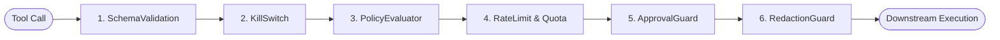

# ⚙️ Technical Requirements Document (TRD) — AgentGate

---

## 1. Document Control & Metadata
- **Document Title**: Technical Requirements & System Architecture Specification
- **Product**: AgentGate AI Governance Gateway
- **Version**: 1.0.0
- **Status**: APPROVED / ACTIVE
- **Target Platform**: Java 21 LTS | Spring Boot 4.x | PostgreSQL 16+ | Redis 7+

---

## 2. Architectural Blueprint & Design Patterns

### 2.1 Architectural Style: Modular Monolith
AgentGate is engineered as a **Modular Monolith** organized into cohesive, feature-oriented packages. It encapsulates domain logic within clean boundaries while sharing the same JVM process and database connection pool to eliminate distributed transaction latency and microservice network hops.

```text
com.agentgate
├── shared/            # Common records, ApiResponse<T>, ApiError, constants, base exceptions
├── security/          # OAuth2 resource server, token extraction, ContextSnapshot filter
├── agent/             # Agent registration, credential hashing (BCrypt), status
├── tool/              # Tool registry, OpenAPI parser, downstream MCP & REST adapters
├── policy/            # Policy versioning, immutable rules tree, AST evaluator, playground
├── invocation/        # Invocation lifecycle orchestrator, execution pipeline
├── approval/          # Human-in-the-loop state machine, encrypted args, digest verification
├── audit/             # Tamper-evident hash chain, advisory lock append, export/verify
├── quota/             # Sliding-window rate limiting & daily UTC spend quotas (Redis Lua)
├── killswitch/        # Emergency stop service with Redis mirror
├── health/            # Resilience4j circuit breakers & tool health probes
├── alert/             # Security breach detection and administrator alerts
└── outbox/            # Transactional outbox publisher with exponential backoff & replay
```

### 2.2 Applied Design Patterns
1. **Ports and Adapters (Hexagonal Architecture)**: Inbound ports (`/mcp`, `/api/v1/*`) and outbound ports (`McpClientPort`, `RestClientPort`, `EventPublisherPort`) isolate business logic from protocol specifics.
2. **Chain of Responsibility / Composite Pattern**: The `GovernancePipeline` executes an ordered sequence of pluggable `GovernanceGuard` components. Any guard can halt execution with a terminal decision.
3. **Transactional Outbox Pattern**: State mutations and corresponding outbound domain events are committed in the same database transaction, eliminating dual-write hazards.
4. **Finite State Machine**: Strict state transitions for both `TOOL_INVOCATION` and `APPROVAL_REQUEST` backed by optimistic locking (`@Version`).

---

## 3. Ingress & Security Specification

### 3.1 OAuth2 Resource Server
- Inbound requests to `/mcp` and `/api/v1/*` require an `Authorization: Bearer <token>` header.
- The resource server validates:
  - Cryptographic signature (RSA-256 / Ed25519) via JWKS endpoint or symmetric secret.
  - Token expiration (`exp`) and clock skew tolerance ($\le 60\text{ seconds}$).
  - Audience (`aud`) matching `agentgate-gateway`.
  - Issuer (`iss`) matching the trusted Identity Provider.
  - Required OAuth2 scopes (e.g. `agent:invoke`, `admin:write`).

### 3.2 Principal Injector & `ContextSnapshot`
```java
public record ContextSnapshot(
    String agentId,
    String agentName,
    Set<String> scopes,
    EndUserContext endUser,
    String correlationId,
    Instant authenticatedAt
) {
    public record EndUserContext(
        String userId,
        String issuer,
        String clearanceLevel
    ) {}
}
```
- Inbound headers attempting to spoof identity (e.g., `X-Agent-ID`, `X-User-ID`) are strictly rejected.
- The `ContextSnapshot` is bound to the request thread using Java 21 **Virtual Threads** via a request-scoped bean or `ThreadLocal`.

---

## 4. Governance Pipeline Specification

Every invocation passes through `GovernancePipeline.execute(InvocationContext context)` prior to downstream execution.



### 4.1 Stage 1: `SchemaValidationGuard`
- **Specification**: Evaluates `request_arguments` against the tool's registered JSON Schema (Draft 7 / 2020-12).
- **Implementation**: Uses `com.networknt:json-schema-validator`.
- **Fail Fast**: If arguments contain undeclared properties, missing required fields, or type mismatches, the request is terminated with `SCHEMA_VALIDATION_FAILED` (no downstream execution).

### 4.2 Stage 2: `KillSwitchGuard`
- **Specification**: Validates that no emergency stop is active.
- **Latency Target**: $\le 2\text{ ms}$ evaluation via Redis cache.
- **Checked Keys**:
  1. `killswitch:global_writes`
  2. `killswitch:agent:<agent_id>`
  3. `killswitch:tool:<tool_id>`
- **Behavior**: If active, cancels any related pending approvals and terminates with `KILL_SWITCH_ACTIVE`.

### 4.3 Stage 3: `PolicyEvaluator`
- **Specification**: Resolves effective policies and evaluates rule trees against the normalized arguments.
- **Default Deny**: If no matching rule yields an `ALLOW` or `REQUIRE_APPROVAL` decision, the invocation is denied with `POLICY_DENIED`.
- **Version Pinning**: The active `POLICY_VERSION` ID and its content hash are pinned to the `TOOL_INVOCATION` record.
- **Precedence Hierarchy**:
  $$\text{GLOBAL} < \text{AGENT} < \text{TOOL} < \text{AGENT\_TOOL}$$
  Within identical scopes, rules are ordered by `priority ASC`.

### 4.4 Stage 4: `RateLimit + Quota Guard`
- **Specification**: Enforces sliding-window request rates and daily cumulative spend caps.
- **Atomic Lua Script**:
  ```lua
  -- Rate limiting & quota check in a single atomic script
  local rate_key = KEYS[1]
  local quota_key = KEYS[2]
  local now = tonumber(ARGV[1])
  local window_sec = tonumber(ARGV[2])
  local max_requests = tonumber(ARGV[3])
  local cost = tonumber(ARGV[4])
  local max_quota = tonumber(ARGV[5])

  -- 1. Check Rate Limit (Sliding Window Log)
  local clear_before = now - window_sec
  redis.call('ZREMRANGEBYSCORE', rate_key, '-inf', clear_before)
  local current_reqs = redis.call('ZCARD', rate_key)
  if current_reqs >= max_requests then
      return {0, "RATE_LIMIT_EXCEEDED"}
  end

  -- 2. Check Daily Quota
  local current_spend = tonumber(redis.call('GET', quota_key) or "0")
  if current_spend + cost > max_quota then
      return {0, "QUOTA_EXCEEDED"}
  end

  -- 3. Apply increments
  redis.call('ZADD', rate_key, now, now)
  redis.call('EXPIRE', rate_key, window_sec * 2)
  redis.call('INCRBY', quota_key, cost)
  -- Daily quota TTL set to end of current UTC day
  return {1, "OK"}
  ```

### 4.5 Stage 5: `ApprovalGuard`
- **Specification**: Evaluates if human sign-off is required based on policy or risk tier (`risk_level == HIGH || CRITICAL`).
- **Cryptographic Binding**: Computes `arguments_hash = SHA256(canonicalJson(request_arguments))`.
- **State Transition**: Creates `APPROVAL_REQUEST` in state `PENDING` with an expiration deadline ($T_{\text{now}} + \Delta t$).
- **Argument Editing Contract**: If an operator alters arguments, the system forces a mandatory rerun of Schema, Policy, Kill Switch, and Quota guards against the edited payload.

### 4.6 Stage 6: `RedactionGuard`
- **Inbound & Outbound**: Scans arguments before downstream dispatch and response payloads before returning to the caller.
- **Masking Patterns**:
  - Email: `(?i)([a-z0-9._%+-])[a-z0-9._%+-]*@([a-z0-9.-]+\.[a-z]{2,})` $\rightarrow$ `$1***@$2`
  - Bangladesh Phone: `(\+8801[3-9]\d{2})\d{4}(\d{2})` $\rightarrow$ `$1****$2`
  - Bangladesh NID: `\b(\d{2})\d{6,13}(\d{2})\b` $\rightarrow$ `NID-$1****$2`
- **Truncation Limit**: Enforces a maximum response ceiling (default: 100 KB). Over-limit responses are truncated with a machine-readable trailer.

---

## 5. Persistence & Cryptographic Hash Chain

### 5.1 Append-Only Audit Trail Architecture
Audit integrity is achieved through an unbroken, SHA-256 cryptographic hash chain:

$$\text{curr\_hash} = \text{SHA-256}(\text{prev\_hash} \,\|\, \text{sequence\_number} \,\|\, \text{event\_time} \,\|\, \text{canonical\_payload})$$

```sql
-- Concurrency Serialization via Transaction-Level Advisory Lock
SELECT pg_advisory_xact_lock(hashtext('audit_chain_partition_global'));

-- Fetch latest chain head
SELECT curr_hash, sequence_number FROM audit_event ORDER BY audit_id DESC LIMIT 1 FOR UPDATE;

-- Insert new event
INSERT INTO audit_event (invocation_id, sequence_number, event_type, event_time, payload, prev_hash, curr_hash, actor)
VALUES (?, ?, ?, ?, ?, ?, ?, ?);
```

### 5.2 Transactional Outbox Pattern
To guarantee reliable messaging without distributed transaction overhead:
1. Business mutations (`tool_invocation`, `approval_request`) and domain events (`event_publication`) are committed in the same database transaction.
2. A background `OutboxDispatcher` polls uncompleted records, dispatches events to external queues or webhooks, and applies exponential backoff on transient errors.

---

## 6. Resilience, Downstream Adapters & Fault Modes

### 6.1 Downstream Adapters
- **MCP Adapter**: Implements JSON-RPC 2.0 client over Spring AI's WebClient / HTTP transports.
- **REST Adapter**: Executes HTTP calls against OpenAPI-defined endpoints with strict parameter mapping.
- **SSRF Defense**: Before dispatching external HTTP calls, all hostnames are resolved to IP addresses and validated against an RFC 1918 / link-local deny list.

### 6.2 Resilience4j Circuit Breaker Configuration
```yaml
resilience4j.circuitbreaker:
  instances:
    downstreamTools:
      slidingWindowType: COUNT_BASED
      slidingWindowSize: 20
      minimumNumberOfCalls: 5
      failureRateThreshold: 50.0
      waitDurationInOpenState: 10000ms
      permittedNumberOfCallsInHalfOpenState: 3
      automaticTransitionFromOpenToHalfOpenEnabled: true
```

### 6.3 Timeout & Unknown Outcome Semantics
- Every downstream invocation enforces a hard timeout (default: $5000\text{ ms}$).
- If an HTTP write operation times out after the TCP handshake, the outcome is marked `UNKNOWN_OUTCOME`. **Blind retries are strictly prohibited** to prevent duplicate charges or side effects.

### 6.4 Failure Mode Behavior Matrix
| Failure Scenario | Gateway Behavior |
|---|---|
| **Redis Outage** | Rate limits & quotas fall back to PostgreSQL database counters. Low-latency kill-switch checks fall back to DB query. |
| **PostgreSQL Outage** | Medium & high-risk tool calls fail closed immediately. Low-risk read calls may use cached policy for $\le 5\text{ minutes}$. |
| **Downstream Outage** | Circuit breaker trips; degraded tool is hidden from MCP discovery; invocations fast-fail with `TOOL_UNAVAILABLE`. |

---

## 7. Quality Attributes & Verification Architecture

### 7.1 Automated Testing Matrix
1. **Unit Tests (JUnit 5 + Mockito)**:
   - Policy precedence resolution, default-deny evaluation, argument condition filtering.
   - JSON Schema validation, normalization, and coercion.
   - PII redaction regexes and response truncation notices.
   - Approval state machine transitions and expired request reaping.
2. **Integration Tests (Testcontainers)**:
   - Real PostgreSQL 16 container running Flyway migrations from clean state.
   - Real Redis 7 container verifying atomic Lua script rate limiters and Pub/Sub invalidations.
   - Concurrent audit append testing under multi-threaded advisory locks.
3. **Security Test Suite**:
   - Forged identity injection (`X-Agent-ID`, tampered JWT claims).
   - Prompt injection argument smuggling.
   - SSRF attempts to `http://169.254.169.254/latest/meta-data/` or `http://127.0.0.1:8080`.
   - Replay attacks on approved requests.

---

## 8. Deployment & DevOps Architecture

### 8.1 Docker Compose Local Topology
```yaml
services:
  agentgate-postgres:
    image: postgres:16-alpine
    environment:
      POSTGRES_DB: agentgate
      POSTGRES_USER: agentgate
      POSTGRES_PASSWORD: ${DB_PASSWORD:-agentgate_secret}
    ports:
      - "5432:5432"
    volumes:
      - postgres_data:/var/lib/postgresql/data
    healthcheck:
      test: ["CMD-SHELL", "pg_isready -U agentgate"]
      interval: 5s
      timeout: 5s
      retries: 5

  agentgate-redis:
    image: redis:7-alpine
    ports:
      - "6379:6379"
    command: ["redis-server", "--appendonly", "yes"]
    volumes:
      - redis_data:/data
    healthcheck:
      test: ["CMD", "redis-cli", "ping"]
      interval: 5s
      timeout: 5s
      retries: 5

volumes:
  postgres_data:
  redis_data:
```

### 8.2 GitHub Actions CI/CD Pipeline
- Automated checkouts on all PRs to `main`.
- Setup Java 21 LTS with Maven cache.
- Execute Docker Compose test services.
- Run `mvn clean verify` (spotless formatting, unit tests, Testcontainers integration tests).
